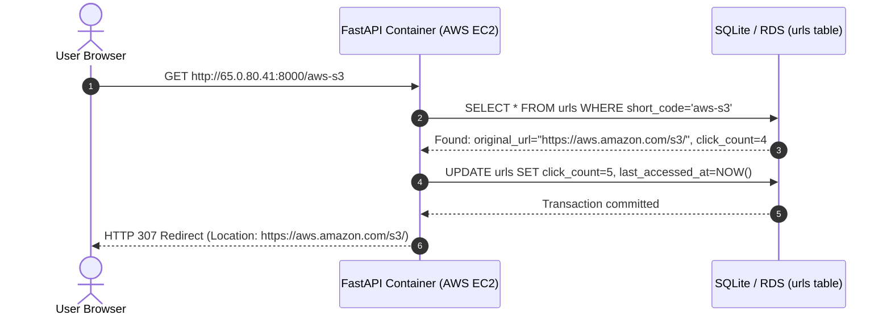

# Lab 10: Access Tracking & Click Analytics

## 1. Overview
In this lab, we implement real-time **Access Tracking and Analytics**:
1. **Click Counting**: Every time `GET /{short_code}` is requested, the system automatically increments `click_count` by 1.
2. **Access Timestamps**: Records the exact UTC timestamp (`last_accessed_at`) of the most recent redirection.
3. **Database Persistence**: Stores access counts permanently in the SQLite `urls` table.
4. **Statistics Display**:
   - `GET /api/urls/{short_code}/stats`: Displays individual link statistics (click count, creation date, last accessed date).
   - `GET /api/stats/summary`: Displays global aggregate statistics (total links, total clicks served, top performing link).

---

## 2. Access Tracking Architecture Flow



---

## 3. Cloud Architecture & AWS Analytics Streaming

In high-scale cloud production (handling millions of clicks per second):

```text
┌────────────────────────────────────────────────────────────────────────┐
│             Real-Time vs. High-Throughput Event Streaming              │
├────────────────────┬───────────────────────────────────────────────────┤
│ Current Simulation │ AWS Production Streaming Pipeline                 │
├────────────────────┼───────────────────────────────────────────────────┤
│ Direct SQLite      │ 1. Click event published to Amazon Kinesis / SQS. │
│ commit on every    │ 2. AWS Lambda worker batches click events.         │
│ HTTP redirect.     │ 3. Atomic counter updated in Amazon DynamoDB.     │
│                    │ 4. Cold data archived to Amazon S3 for Athena.   │
└────────────────────┴───────────────────────────────────────────────────┘
```

This streaming pattern (depicted in our architecture diagram) prevents database write-lock bottlenecks during sudden viral traffic surges!

---

## 4. Endpoints Implemented in Lab 10

| Method | Endpoint | Description |
| :--- | :--- | :--- |
| **GET** | `/{short_code}` | Redirects user AND increments `click_count` + updates `last_accessed_at`. |
| **GET** | `/api/urls/{short_code}/stats` | Displays click count, creation date, and last accessed timestamp. |
| **GET** | `/api/stats/summary` | Aggregates service-wide analytics (total links, total clicks, top link). |

---

## 5. How to Test on Your AWS Server (Where to Go & What to Click)

### Step 1: Check Initial Stats (Click Count = 0)
1. In your browser, open Swagger: **`http://65.0.80.41:8000/docs`**
2. Expand **`GET /api/urls/{short_code}/stats`** ➔ Click **Try it out**.
3. Enter `short_code`: **`aws-s3`** ➔ Click **Execute**.
4. Notice `click_count: 0` and `last_accessed_at: null`.

### Step 2: Trigger Clicks
1. In a new tab, visit: **`http://65.0.80.41:8000/aws-s3`** (Click 1)
2. Refresh or open again: **`http://65.0.80.41:8000/aws-s3`** (Click 2)
3. Refresh once more: **`http://65.0.80.41:8000/aws-s3`** (Click 3)

### Step 3: Verify Updated Click Count
1. Return to Swagger UI and click **Execute** on `GET /api/urls/aws-s3/stats` again.
2. Watch the stats update live:
   ```json
   {
     "short_code": "aws-s3",
     "original_url": "https://aws.amazon.com/s3/",
     "click_count": 3,
     "created_at": "2026-10-13T...",
     "last_accessed_at": "2026-10-13T19:00:00.000000+00:00",
     "is_active": true,
     "status": "active"
   }
   ```

### Step 4: View Global Service Analytics
1. In Swagger UI, expand **`GET /api/stats/summary`** ➔ Click **Try it out** ➔ **Execute**.
2. Returns total links created, total redirections served, and your most clicked link!

---

## 6. Verification Checklist

- [x] Click counter increments on every redirection.
- [x] Last accessed timestamp updated on each access.
- [x] Increments permanently persisted in SQLite disk storage.
- [x] Implemented individual link stats and global summary analytics endpoints.
- [x] 20 automated unit tests executed and passed.
