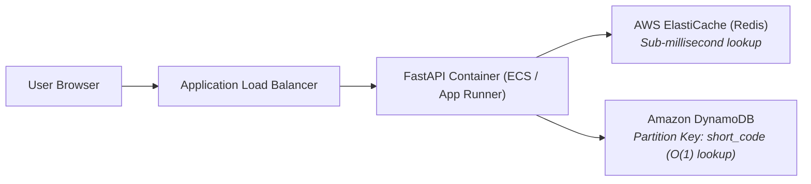

# Lab 5: Generate Short Codes & URL Mapping

## 1. Overview
In this lab, we build the core short-code generation engine for our Cloud-Based URL Shortener:
1. **Base62 Encoding**: Generate compact, collision-resistant, 6-character short codes from the alphanumeric alphabet `[0-9a-zA-Z]`.
2. **URL-to-Code Mapping**: Connect each generated short code with its corresponding original long URL.
3. **Custom Vanity Alias Support**: Allow users to specify custom aliases (e.g., `aws-blog`) with conflict prevention (HTTP 409 Conflict).
4. **Batch Shortening**: Provide an endpoint to shorten multiple URLs in a single request.

---

## 2. The Mathematics & Engineering of Base62

### Why Base62 Instead of Base64 or Hexadecimal?
| Encoding System | Character Set | URL Safety | Capacity at Length 6 |
| :--- | :--- | :--- | :--- |
| **Hexadecimal (Base16)** | `0-9`, `a-f` (16 chars) | Safe | $16^6 = 16.7\text{ million}$ combinations |
| **Base64** | `0-9`, `a-z`, `A-Z`, `+`, `/` (64 chars) | **Unsafe** (`+` and `/` require URL encoding) | $64^6 = 68.7\text{ billion}$ |
| **Base62 (Industry Standard)** | `0-9`, `a-z`, `A-Z` (62 chars) | **100% Safe** in URL paths without encoding | **$62^6 \approx 56.8\text{ billion}$** combinations |

With a 6-character Base62 string, the system can generate over **56.8 billion** unique URLs before exhausting the address space. Expanding to 7 characters provides **$62^7 \approx 3.52\text{ trillion}$** unique short codes!

---

## 3. Cloud Architecture & AWS Mapping

In AWS cloud architecture, how do short-code lookups achieve ultra-low latency?



1. **Amazon DynamoDB as Primary Store**:
   - `short_code` is designated as the **Partition Key (PK)**.
   - DynamoDB hashes the partition key across SSD storage nodes, providing consistent **single-digit millisecond $O(1)$ lookups** regardless of database size.
2. **Amazon ElastiCache (Redis)**:
   - Hot URLs (frequently clicked short codes) are cached in-memory in Redis, bypassing the database entirely for sub-millisecond response times.

---

## 4. Endpoints Implemented in Lab 5

| Method | Endpoint | Description | HTTP Status |
| :--- | :--- | :--- | :--- |
| **POST** | `/api/shorten` | Shortens a single URL; auto-generates Base62 code or validates custom alias | `201 Created` |
| **POST** | `/api/shorten/batch` | Accepts a list of multiple URLs and returns their generated short codes | `201 Created` |
| **GET** | `/api/mappings` | Lists all active short-code to original-URL connections | `200 OK` |

---

## 5. How to Test (Where to Go & What to Click)

### Option A: Interactive Swagger UI
Open your browser at: 👉 [**http://127.0.0.1:8000/docs**](http://127.0.0.1:8000/docs)

#### 1. Test Single Short Code Generation:
- Expand **`POST /api/shorten`** ➔ Click **Try it out**.
- Enter JSON:
  ```json
  {
    "url": "https://aws.amazon.com/solutions/case-studies/"
  }
  ```
- Click **Execute**.
- Observe the response containing `short_code` (e.g., `"k7Px9Z"`) and `short_url` (e.g., `"http://127.0.0.1:8000/k7Px9Z"`).

#### 2. Test Custom Vanity Alias:
- In `POST /api/shorten`, enter:
  ```json
  {
    "url": "https://aws.amazon.com/dynamodb/",
    "custom_code": "aws-dynamo"
  }
  ```
- Click **Execute** ➔ Returns short code `"aws-dynamo"`.
- Click **Execute** again with the same custom code ➔ Returns `409 Conflict` (*"Custom short code 'aws-dynamo' is already taken"*).

#### 3. Test Multiple URLs (Batch Test):
- Expand **`POST /api/shorten/batch`** ➔ Click **Try it out**.
- Enter JSON:
  ```json
  {
    "urls": [
      "https://aws.amazon.com/ec2/",
      "https://aws.amazon.com/s3/",
      "https://aws.amazon.com/lambda/",
      "https://aws.amazon.com/cloudwatch/"
    ]
  }
  ```
- Click **Execute** ➔ Verify all 4 URLs receive unique short codes simultaneously.

#### 4. View Stored Mappings:
- Expand **`GET /api/mappings`** ➔ Click **Try it out** ➔ Click **Execute**.
- View all generated mappings in active memory.

---

## 6. Verification Checklist

- [x] Base62 character generation algorithm implemented in `app/utils.py`.
- [x] Custom alias conflict detection and error handling implemented.
- [x] Dynamic `short_url` generation based on request host header.
- [x] Batch shortening endpoint `/api/shorten/batch` created for multi-URL testing.
- [x] 12 automated unit tests executed in `tests/test_api.py` with 100% pass rate.
