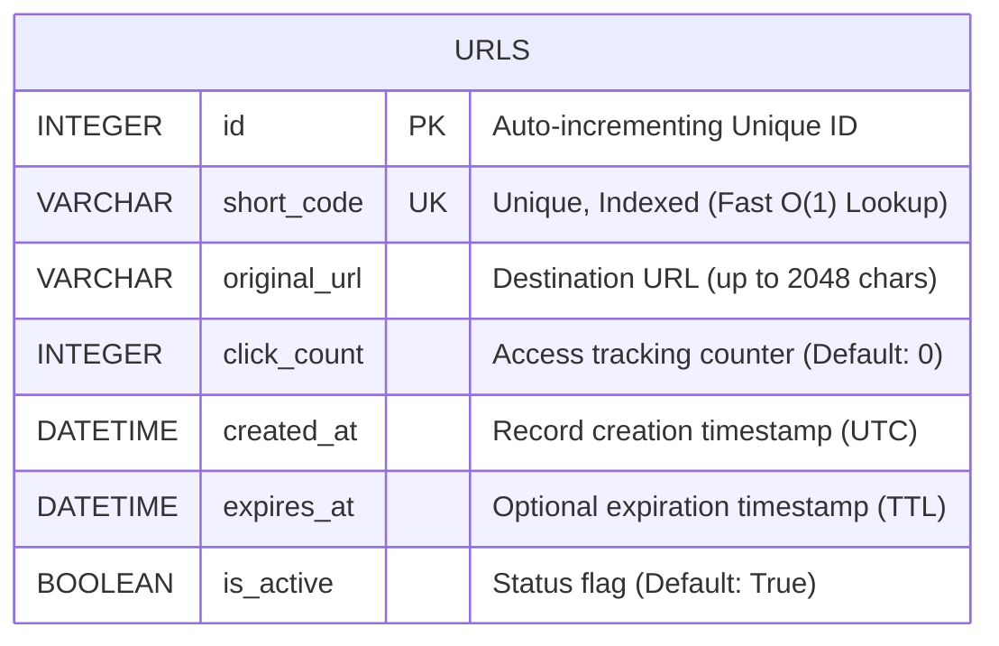

# Lab 6: SQLite Database Design & Storage

## 1. Overview
In this lab, we transition from ephemeral in-memory storage to a persistent relational database:
1. **Engine Setup**: Initialized SQLite database engine and session factory with **SQLAlchemy 2.0**.
2. **Schema Definition**: Created the `urls` table schema (`URLItem` model) with indexed short-code columns.
3. **Data Persistence**: Implemented automated table creation on application startup and seeded initial URL records.

---

## 2. Database Schema: The `urls` Table



### Column Specifications
| Column Name | SQL Type | Modifiers | Purpose |
| :--- | :--- | :--- | :--- |
| **`id`** | `INTEGER` | `PRIMARY KEY`, `AUTOINCREMENT` | Surrogate primary key for internal record tracking. |
| **`short_code`** | `VARCHAR(16)` | `UNIQUE`, `INDEXED`, `NOT NULL` | Lookup key. The B-Tree index guarantees instant lookups. |
| **`original_url`** | `VARCHAR(2048)` | `NOT NULL` | The full destination website URL. |
| **`click_count`** | `INTEGER` | `DEFAULT 0`, `NOT NULL` | Counter incremented on every redirection (Lab 10). |
| **`created_at`** | `DATETIME` | `NOT NULL` | Timestamp when the short link was generated. |
| **`expires_at`** | `DATETIME` | `NULLABLE` | Expiration date for time-limited links (Lab 11). |
| **`is_active`** | `BOOLEAN` | `DEFAULT TRUE`, `NOT NULL` | Flag to immediately revoke access without deleting data. |

---

## 3. Cloud Architecture & AWS Database Mapping

In enterprise cloud architecture, how does SQLite compare to AWS production databases?

```text
┌────────────────────────────────────────────────────────────────────────┐
│                      Database Evolution Matrix                         │
├────────────────────┬────────────────────┬──────────────────────────────┤
│  Local Simulation  │  AWS Managed Relational │ AWS High-Throughput NoSQL│
│  (Lab 6)           │  (Amazon RDS / Aurora)  │ (Amazon DynamoDB)        │
├────────────────────┼────────────────────┼──────────────────────────────┤
│  SQLite (`urls.db`)│ Amazon RDS         │ Amazon DynamoDB              │
│                    │ PostgreSQL / MySQL │                              │
│  Single-file on    │ Managed Multi-AZ   │ Key-Value store with         │
│  local disk;       │ replication;       │ microsecond latency;         │
│  ideal for Dev     │ automated backups; │ auto-scaling write/read      │
│  and testing.      │ read replicas.     │ capacity units.              │
└────────────────────┴────────────────────┴──────────────────────────────┘
```

- **For Relational Cloud Architecture**: SQLite code translates 1-to-1 to **Amazon RDS PostgreSQL** simply by changing the `DATABASE_URL` connection string!
- **For Serverless Cloud Architecture**: The `short_code` becomes a **DynamoDB Partition Key**, where link lookups are distributed evenly across serverless storage partitions.

---

## 4. How to Run & Verify Lab 6 (Where to Go & What to Click)

### Step 1: Run the Database Seeding Script
In your VS Code terminal (or PowerShell):
```powershell
.\venv\Scripts\python.exe scripts/seed_database.py
```

You will see:
```text
============================================================
Lab 6: SQLite Database Initialization & Seeding
============================================================
1. Creating SQLite database & 'urls' table...
   -> Success: Database schema verified.

2. Storing long URLs and short codes into SQLite database...
   [INSERTED] Short Code: 'aws-ec2' -> Target: 'https://aws.amazon.com/ec2/'
   [INSERTED] Short Code: 'aws-s3'  -> Target: 'https://aws.amazon.com/s3/'
   [INSERTED] Short Code: 'aws-rds' -> Target: 'https://aws.amazon.com/rds/'
   -> Transaction successfully committed to SQLite disk!

3. Querying stored records from 'urls' table:
   Total records in SQLite: 5
------------------------------------------------------------
ID   | Short Code   | Clicks | Target URL
------------------------------------------------------------
1    | aws-ec2      | 0      | https://aws.amazon.com/ec2/
2    | aws-s3       | 0      | https://aws.amazon.com/s3/
3    | aws-rds      | 0      | https://aws.amazon.com/rds/
------------------------------------------------------------
```

### Step 2: Verify the SQLite File on Disk
Notice the file [`urls.db`](file:///C:/cloud-url-shortener/urls.db) has been created directly in your `C:\cloud-url-shortener\` root folder.

### Step 3: Run Database Unit Tests
```powershell
.\venv\Scripts\pytest.exe -v tests/test_database.py
```
Both record insertion, retrieval, and unique constraint enforcement tests will pass with 100% success.

---

## 5. Verification Checklist

- [x] Initialized SQLite database engine and session factory in `app/database.py`.
- [x] Defined `URLItem` table model with `short_code` unique index in `app/models.py`.
- [x] Integrated automated database table creation into FastAPI lifespan.
- [x] Stored long URLs and short codes in `urls.db`.
- [x] Automated unit test suite executed (`pytest tests/test_database.py`) with 100% pass rate.
