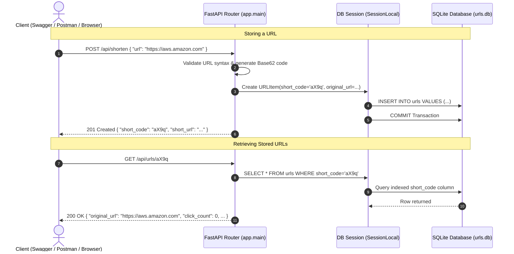

# Lab 7: Store URLs Through API

## 1. Overview
In this lab, we integrate the FastAPI application directly with the persistent SQLite database:
1. **Dependency Injection**: Connected endpoints to SQLite sessions using FastAPI's `Depends(get_db)`.
2. **Automatic Persistence**: Incoming long URLs submitted via `POST /api/shorten` or `POST /api/shorten/batch` are committed directly to disk in `urls.db`.
3. **Retrieval Endpoints**: Implemented `GET /api/urls` (list all stored URLs) and `GET /api/urls/{short_code}` (retrieve single URL metadata).

---

## 2. API & Database Architecture Flow



---

## 3. Cloud Architecture & AWS Mapping

### Why Database Connection Pooling Matters in Cloud Systems
In a scalable cloud environment (e.g., **AWS App Runner**, **ECS Fargate**, or **AWS Lambda**), hundreds of container replicas can be spun up during high traffic:

1. **Connection Lifecycle Management**:
   - The `get_db()` dependency generator guarantees that every database connection is cleanly returned to the pool once the HTTP response is dispatched.
   - Prevents **connection leaks** that could crash the database server.
2. **AWS RDS Proxy**:
   - In production on AWS, an **Amazon RDS Proxy** sits between your containerized FastAPI application and your **Amazon Aurora / RDS PostgreSQL** database.
   - RDS Proxy multiplexes thousands of incoming application connections into a fixed pool of database connections, increasing throughput and preventing database connection exhaustion.

---

## 4. Endpoints Implemented in Lab 7

| Method | Endpoint | Description | Status Code |
| :--- | :--- | :--- | :--- |
| **POST** | `/api/shorten` | Validates, generates code, and stores URL in SQLite | `201 Created` / `409 Conflict` |
| **POST** | `/api/shorten/batch` | Saves multiple URLs to SQLite in an atomic batch transaction | `201 Created` |
| **GET** | `/api/urls` | Retrieves all stored URLs with pagination (`skip`, `limit`) | `200 OK` |
| **GET** | `/api/urls/{short_code}` | Retrieves a specific stored URL by its short code | `200 OK` / `404 Not Found` |

---

## 5. How to Test (Where to Go & What to Click)

### Option A: Interactive Swagger UI
Open your browser at: 👉 [**http://127.0.0.1:8000/docs**](http://127.0.0.1:8000/docs)  
*(Start server if needed: `.\venv\Scripts\uvicorn.exe app.main:app --reload --port 8000`)*

#### Step 1: Submit and Store a New URL
1. Expand **`POST /api/shorten`** ➔ Click **Try it out**.
2. Enter JSON:
   ```json
   {
     "url": "https://aws.amazon.com/rds/aurora/",
     "custom_code": "aws-aurora"
   }
   ```
3. Click **Execute** ➔ Verify `201 Created`. The URL is now stored in SQLite!

#### Step 2: Retrieve the Stored URL by Code
1. Expand **`GET /api/urls/{short_code}`** ➔ Click **Try it out**.
2. Enter `short_code`: `aws-aurora`.
3. Click **Execute** ➔ Returns:
   ```json
   {
     "id": 1,
     "short_code": "aws-aurora",
     "original_url": "https://aws.amazon.com/rds/aurora/",
     "click_count": 0,
     "created_at": "2026-10-13T...",
     "is_active": true
   }
   ```

#### Step 3: Retrieve All Stored URLs
1. Expand **`GET /api/urls`** ➔ Click **Try it out** ➔ Click **Execute**.
2. View all records currently saved on disk in `urls.db`.

---

## 6. Verification Checklist

- [x] Connected FastAPI endpoints to SQLite using SQLAlchemy session dependency (`Depends(get_db)`).
- [x] Automated URL insertion and transaction committing on `POST /api/shorten`.
- [x] Implemented `GET /api/urls` and `GET /api/urls/{short_code}` with 404 error handling.
- [x] Verified data persistence across server restarts in `urls.db`.
- [x] Automated unit test suite executed with 100% pass rate.
