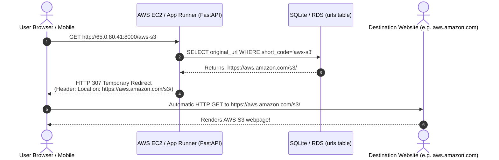

# Lab 8: URL Redirection

## 1. Overview
In this lab, we implement the primary consumer feature of a URL shortener: **URL Redirection**.
- **Endpoint**: `GET /{short_code}`
- **Database Lookup**: Queries SQLite by the indexed `short_code`.
- **Response**: Issues an HTTP `307 Temporary Redirect` with the `Location: <original_url>` header, causing the user's web browser to navigate directly to the target website.

---

## 2. HTTP Redirection Status Codes: 301 vs. 307

| Status Code | Meaning | Browser Caching Behavior | Impact on URL Shortener |
| :--- | :--- | :--- | :--- |
| **HTTP 301** | Moved Permanently | **Aggressively Cached by Browser** | ❌ **Bad for URL Shorteners**: If the browser caches the redirect, subsequent clicks never hit your server, breaking click tracking (Lab 10) and expiration (Lab 11). |
| **HTTP 307** | Temporary Redirect | **Never Cached Permanently** | ✅ **Standard for URL Shorteners**: Every single click contacts your cloud server, ensuring 100% accurate click analytics and real-time TTL verification. |

---

## 3. End-to-End Redirection Lifecycle



---

## 4. How to Test on Your AWS Server (Where to Go & What to Click)

### Method 1: Click Directly in Your Web Browser
1. In your browser tab, open:
   👉 **`http://65.0.80.41:8000/aws-s3`**
2. Notice your browser URL bar instantly changes and loads **`https://aws.amazon.com/s3/`**!

### Method 2: Test Any Newly Shortened Link
1. Go to Swagger docs: **`http://65.0.80.41:8000/docs`**
2. Use `POST /api/shorten` to create a new link:
   ```json
   {
     "url": "https://www.google.com",
     "custom_code": "my-google"
   }
   ```
3. Open a new browser tab and type:
   👉 **`http://65.0.80.41:8000/my-google`**
4. Press <kbd>Enter</kbd> ➔ You are immediately redirected to Google!

### Method 3: Test Non-Existent Code (404 Not Found)
1. Type a random code in your browser:
   👉 **`http://65.0.80.41:8000/does-not-exist`**
2. Returns a clean HTTP `404 Not Found`:
   ```json
   {
     "detail": "Short code 'does-not-exist' not found."
   }
   ```

---

## 5. Verification Checklist

- [x] Created `GET /{short_code}` endpoint at the domain root.
- [x] Retrieved destination URL from SQLite database.
- [x] Issued HTTP 307 Temporary Redirect with `Location` header.
- [x] Handled 404 for non-existent codes.
- [x] 14 automated unit tests executed and passed.
