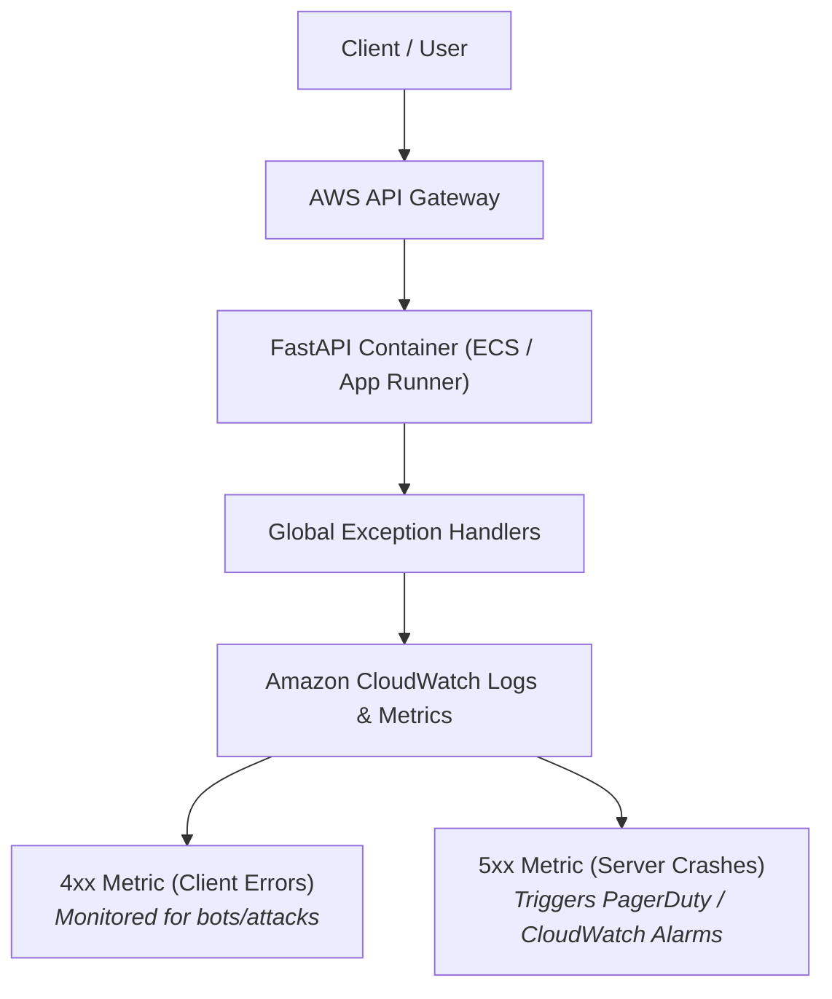

# Lab 9: Comprehensive Error Handling

## 1. Overview
In this lab, we implement centralized, production-grade error handling for our Cloud URL Shortener:
1. **Invalid URLs**: Strict validation rejecting unsupported schemes (`ftp://`, `javascript:`, `file://`) and broken domain structures with clean HTTP `400 Bad Request` messages.
2. **Empty Input**: Rejects missing fields, empty strings, and whitespace payloads with HTTP `400 Bad Request`.
3. **Non-Existing Short Codes**: Handled across both redirection (`GET /{short_code}`) and data retrieval (`GET /api/urls/{short_code}`) with standardized HTTP `404 Not Found`.
4. **Duplicate URLs**:
   - **Duplicate Custom Alias**: Returns HTTP `409 Conflict` if a vanity code is already taken.
   - **Duplicate Long URL (Idempotent Cloud Pattern)**: If a user resubmits an identical long URL without a custom code, the API returns the existing active short code instead of duplicating database records.

---

## 2. Standardized Cloud Error Response Format

All errors return a predictable, machine-readable JSON structure conforming to cloud API best practices:

```json
{
  "error": true,
  "status_code": 400,
  "detail": "Unsupported URL scheme 'ftp'. Only 'http://' and 'https://' are permitted.",
  "path": "/api/shorten",
  "timestamp": "2026-10-13T18:50:00.000000+00:00"
}
```

---

## 3. Error Handling Matrix

| Scenario | Input Example | HTTP Status Code | Response Behavior |
| :--- | :--- | :--- | :--- |
| **Invalid Scheme** | `{"url": "ftp://archive.org"}` | **`400 Bad Request`** | Returns exact protocol failure explanation. |
| **Invalid Domain** | `{"url": "https://not a domain"}` | **`400 Bad Request`** | Returns domain syntax rejection. |
| **Empty String** | `{"url": ""}` | **`400 Bad Request`** | Rejects with `"URL cannot be empty."` |
| **Missing Body** | `{}` | **`400 Bad Request`** | Rejects missing required field `url`. |
| **Missing Short Code** | `GET /non-existent-code` | **`404 Not Found`** | Returns `"Short code '...' not found."` |
| **Duplicate Vanity Alias** | Submitting an existing `custom_code` | **`409 Conflict`** | Alerts user that alias is already taken. |
| **Duplicate Long URL** | Resubmitting the same target URL | **`200 OK (Reused)`** | Reuses existing short code; prevents database bloat. |

---

## 4. Cloud Architecture & AWS Monitoring Mapping

In cloud architectures (e.g., **AWS API Gateway + CloudWatch**):



1. **Clean Error Boundaries**:
   - By intercepting exceptions at the API layer, server processes never crash or leak internal database stack traces to attackers.
2. **CloudWatch Metrics (4xx vs 5xx)**:
   - Client errors (400, 404, 409) indicate client mistakes (or automated scrapers) and do not alert on-call engineers.
   - Internal crashes (500) trigger automated **CloudWatch Alarms** to restart containers or alert developers.

---

## 5. How to Test (Where to Go & What to Click)

Open Swagger UI on your AWS server: 👉 **`http://65.0.80.41:8000/docs`**

### Test 1: Invalid Scheme (400 Bad Request)
- Expand **`POST /api/shorten`** ➔ Click **Try it out**.
- Enter: `{"url": "ftp://files.example.com"}` ➔ Click **Execute**.
- Verify status **`400 Bad Request`** with clear explanation.

### Test 2: Empty URL (400 Bad Request)
- Enter: `{"url": ""}` ➔ Click **Execute**.
- Verify status **`400 Bad Request`** with `"URL cannot be empty"`.

### Test 3: Non-Existent Code (404 Not Found)
- In a new browser tab, open: `http://65.0.80.41:8000/xyz999`
- Verify clean **`404 Not Found`** JSON response.

### Test 4: Duplicate Vanity Alias (409 Conflict)
- Shorten a link with custom code: `{"url": "https://aws.amazon.com", "custom_code": "my-code"}` (Returns 201).
- Submit a second link with the same custom code: `{"url": "https://google.com", "custom_code": "my-code"}`.
- Verify status **`409 Conflict`** (*"Custom short code 'my-code' is already in use"*).

### Test 5: Duplicate Long URL Reuse
- Submit: `{"url": "https://aws.amazon.com/dynamodb/"}` (Returns 201).
- Submit the exact same URL again without custom code ➔ Returns the existing short code with `status: "success (reused duplicate)"`!

---

## 6. Verification Checklist

- [x] Implemented global exception handlers for `HTTPException` and `RequestValidationError`.
- [x] Handled malformed schemes and domain structures (HTTP 400).
- [x] Handled empty inputs (HTTP 400).
- [x] Handled non-existing short codes (HTTP 404).
- [x] Handled duplicate vanity codes (HTTP 409) and duplicate long URL deduplication.
- [x] 18 automated unit tests executed and passed.
